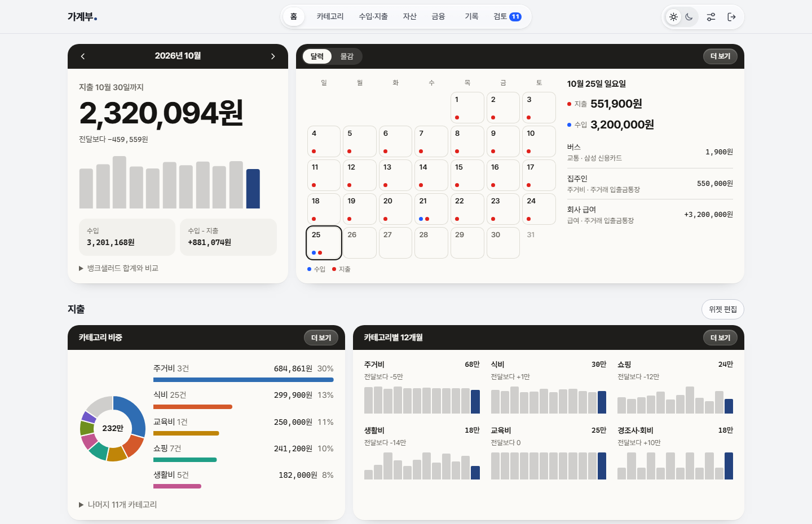
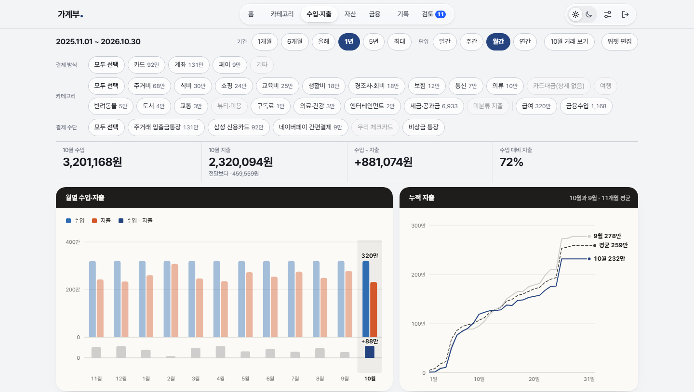
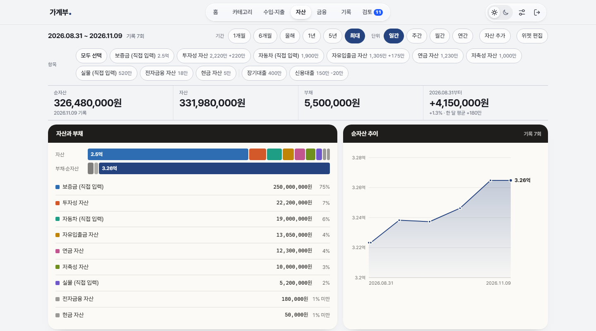
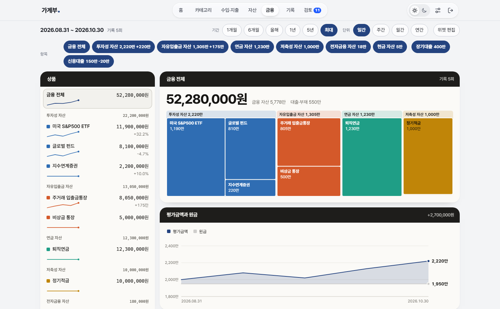
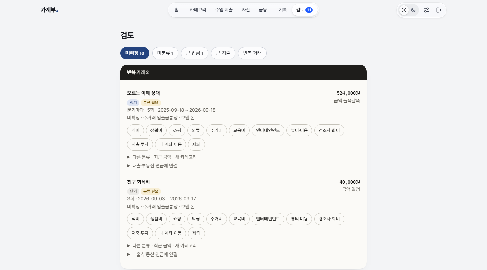
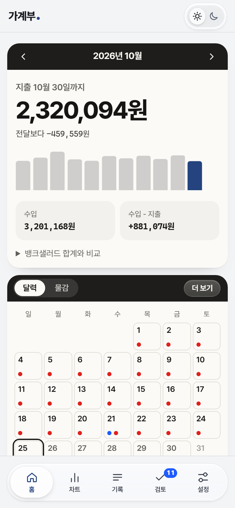
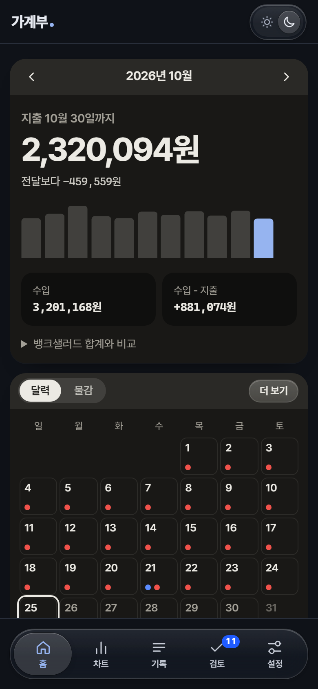

# 개인 가계부

뱅크샐러드 내보내기 메일을 자동으로 받아 연동하는 가계부입니다. 내 계정에 직접 연결해서 사용합니다.

> [!WARNING]
> **공식 배포처는 [github.com/jinsol-git/money-tracker](https://github.com/jinsol-git/money-tracker) 하나뿐입니다.**
>
> 이 앱은 금융 데이터와 Google 계정, 데이터베이스 비밀값을 다룹니다. 다른 저장소나 사이트에서 받은 같은 이름, 비슷한 화면의 앱에는 악성 코드가 들어 있을 수 있으니 설치하지 마세요. 받기 전에 주소부터 확인하세요.
>
> - 설치 파일(exe, apk 등), 앱 스토어 앱, 브라우저 확장 프로그램을 배포하지 않습니다.
> - 설치를 대신해 주거나 호스팅해 주는 서비스를 운영하지 않습니다.
> - 비밀번호, OTP, 복구 코드, 비밀값, 내보내기 파일을 요구하지 않습니다.
>
> [설치 매뉴얼](docs/setup.md)대로 이 저장소에서 내 계정에 Private으로 복사한 것은 괜찮습니다.

## 화면

| 수입·지출 | 자산 |
| :---: | :---: |
|  |  |
| **금융** | **검토** |
|  |  |

  
  &nbsp;&nbsp;
  

## 개발자 코멘트

안녕하세요. 개발자 김진솔입니다.

돈을 관리하면서 답답했던 부분을 직접 풀고 싶어서 이 가계부를 만들었습니다. 앱 하나로 돈과 관련된 관리를 모두 해결하는 것이 목표입니다. [라이선스](LICENSE)를 지키는 범위에서 원하는 기능을 더해 쓰셔도 됩니다.

주요 기능은 아래와 같습니다.

- 내 계좌 이동과 페이 충전이 중복으로 잡히지 않게 걸러 냅니다. 판단하기 어려운 거래는 미확정으로 모아 두고, 확인하면 지출이나 수입에 반영합니다. 월세처럼 반복되는 거래는 한 번 확인하면 다음부터 자동으로 분류합니다.
- 지출과 수입의 흐름을 단순하지만 꼼꼼하게 보여 줍니다. 무심코 하던 소비 습관을 돌아보고, 절약하는 습관을 꾸준히 기를 수 있게 했습니다.
- 짧은 기간의 흐름부터 인생 전체의 자산 현황까지 계속 함께할 수 있도록 구성했습니다.
- 웹 앱이라 휴대폰, 태블릿, PC 어디서든 브라우저로 가계부를 볼 수 있습니다.
- 웹에서 쓰는 만큼 Google 로그인과 OTP 이중 인증, 꼼꼼한 초기 설정으로 보안을 챙겼습니다. 설정을 마친 뒤에는 뱅크샐러드에서 내보내기 메일만 보내면 자동으로 반영됩니다.

보안을 중요하게 다룬 만큼, 개발자가 아닌 분께는 설정이 다소 복잡할 수 있습니다. Codex나 Claude Code 같은 AI 에이전트에게 [설치 매뉴얼](docs/setup.md)을 읽게 하고 순서대로 설정을 마치는 방법을 추천합니다. 비밀값을 만들고 넣는 단계는 직접 하고, 그 값은 AI에게 보여 주지 마세요([막혔을 때](docs/setup.md#막혔을-때) 참고).

직접 써 보시면 충분히 쓸모를 느끼실 거라 생각합니다. 시작이 반이라고 하니, 함께 시작해 볼까요?

**시작하기: [설치 매뉴얼](docs/setup.md)**

## 라이선스

[LICENSE](LICENSE)를 따릅니다. 개인 용도로 설치하고 고쳐 쓸 수 있지만, **화면 하단의 링크와 `© JINSOL KIM` 표시는 지우거나 바꿀 수 없습니다.**

글꼴 Pretendard는 저작권자가 따로 있고 [SIL Open Font License 1.1](public/fonts/LICENSE-Pretendard.txt)을 따릅니다.

Copyright (c) 2026 Jinsol Kim
